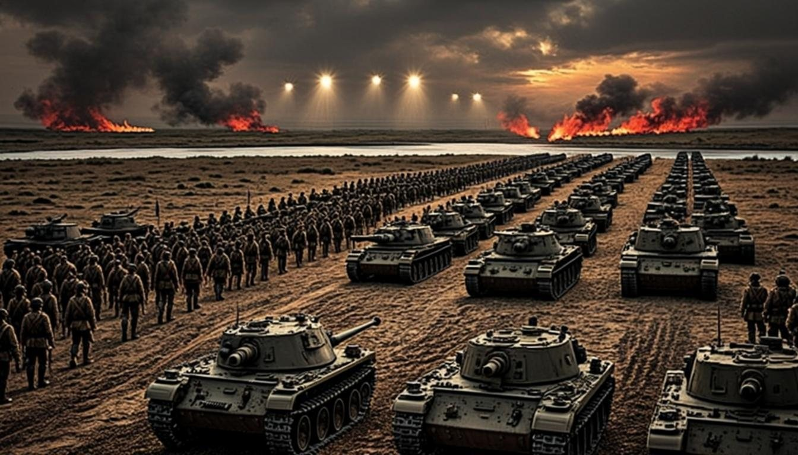

# Iron Meridian

An original, browser-based turn-based tactics game with a small campaign layer,
inspired by the broad gameplay ideas of classic wargames (Panzer General /
LGeneral) but built from scratch: original code, setting, factions, maps,
writing, artwork and sounds.

Command the **Astrian Federation's** Task Force Meridian against the **Karsite
Union** across the continent of Velmora: four handcrafted battles (plus a
guided tutorial), terrain-driven tactics, a persistent force, and a
between-battle choice screen for repairs, training, reinforcements and
objective selection.



## Quick start

```bash
bun install          # install dependencies (or: npm install)
bun run dev          # start the dev server on http://localhost:3000
```

Then open the printed URL (in the Z.ai sandbox, use the Preview Panel /
"Open in New Tab").

### Commands

| Command | What it does |
| --- | --- |
| `bun run dev` | Dev server (Next.js 16, port 3000) |
| `bun run lint` | ESLint (Next.js rules) |
| `bunx tsc --noEmit` | Strict TypeScript check |
| `bun run test` | Full Vitest suite (engine, AI, campaign, saves, UI, limits) |
| `bun run check:lines` | Source-file line-limit check (no file over 400 lines) |
| `bun run check:content` | Validates every content file, prints file/field diagnostics |
| `bun run assets` | Regenerates the AI-generated art in `public/assets/img` |

## How to play

- **Goal:** capture every marked objective (or destroy all enemies) before the
  turn limit. Between battles, spend prestige on repairs, training and
  reinforcements, then choose your next objective — after the second battle
  the campaign branches.
- **A turn:** each unit may move once and attack once, in either order.
  Attacking ends the unit's activation. `End turn (E)` hands over to the AI.
- **Classes:** Rifle Squads hold ground and capture towns; Outrider Cars scout
  and capture fast; Vanguard Tanks hit hardest but hate forests and mountains;
  Bombard Guns strike 2–3 tiles away with no risk of counterattack — but are
  helpless up close.
- **Terrain:** forests, hills, mountains and towns change move costs and
  defense. Hover/click any tile to see its data.
- **Controls:** mouse fully supported. Keyboard: arrows/WASD move the cursor,
  Enter/Space confirms, Esc cancels, Tab cycles units, E ends turn.
- First battle is a guided tutorial that teaches one idea per step.

Saves are stored locally in your browser (`localStorage`) and persist across
sessions; "New Campaign" restarts after an explicit confirmation.

## Documentation

- [`docs/ARCHITECTURE.md`](docs/ARCHITECTURE.md) — module map, data flow,
  where the rules/data/UI boundary lives.
- [`docs/CONTENT-GUIDE.md`](docs/CONTENT-GUIDE.md) — how to add a scenario,
  unit class, terrain type, campaign node, locale or theme change (all JSON,
  no engine code).
- [`docs/LICENSES.md`](docs/LICENSES.md) — licensing and third-party material
  statement.
- [`public/assets/img/ASSETS.md`](public/assets/img/ASSETS.md) — every visual
  asset, its role and generation status.

## Tech stack

Next.js 16 (App Router, single route) · React 19 · TypeScript (strict) ·
Tailwind CSS 4 · shadcn/ui · Zustand · Zod · Vitest + Testing Library ·
Web Audio API (runtime-synthesized SFX). Game rules are a pure-TypeScript
engine (`src/game/`) with zero DOM/React dependencies; all gameplay content is
JSON, validated at startup with actionable diagnostics.

## Status

Complete vertical slice: menu, tutorial, 4 battles + branching campaign,
AI opponent, saves, settings (audio/reduced motion), credits screen, 68
automated tests. Known limitations are listed in the final delivery report.
